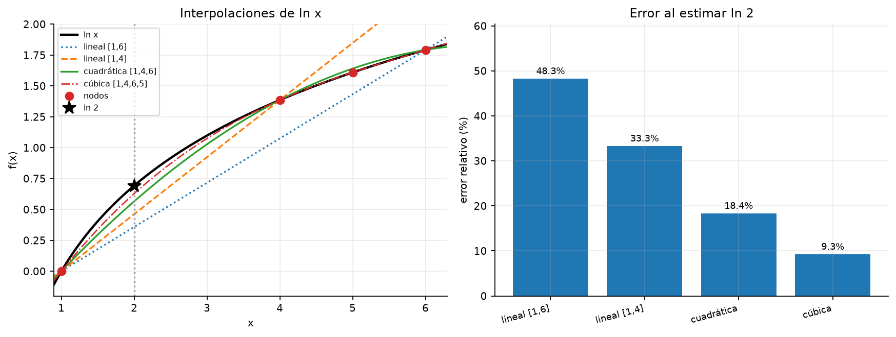
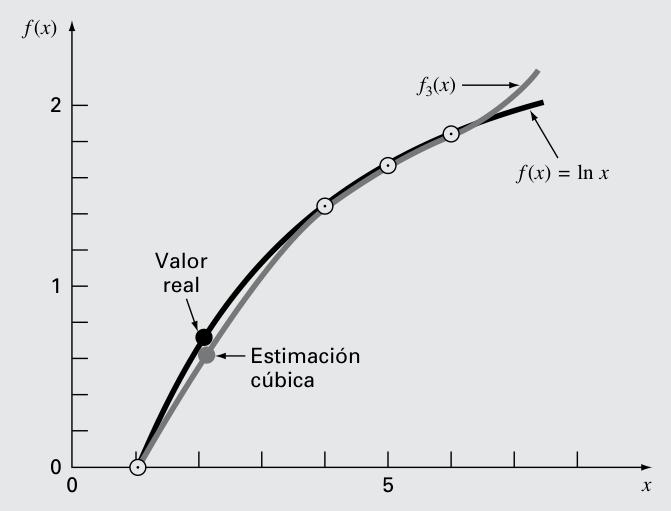

# Caso 01 — Estimar $\ln 2$ con pocos datos

| ⬅️ Índice de casos | 🏠 Inicio |
|:---|:---:|
| [Casos de estudio](README.md) | [README](../../README.md) |



## 1. El problema

Se conocen cuatro valores de $\ln x$:

| $x$ | 1 | 4 | 5 | 6 |
|---|---|---|---|---|
| $\ln x$ | 0 | 1.386294 | 1.609438 | 1.791759 |

Hay que estimar $\ln 2=0.6931472$ **sin calculadora**. Los datos son exactos
(provienen de una tabla), el punto $x=2$ está dentro del intervalo y se quiere
el menor error posible con la información disponible.

## 2. ¿Interpolar o ajustar?

**Interpolar.** Los cuatro valores son exactos y el punto de consulta está
rodeado por los nodos. Ajustar por mínimos cuadrados tendría menos coeficientes
que datos y no pasaría por ellos; aquí no hay ruido que suavizar.

## 3. Método recomendado: Newton cúbico

Con cuatro nodos, el polinomio de grado 3 es el de mayor grado que los datos
sostienen. Es el mejor equilibrio porque:

- el error baja a **9.3%**, la mitad del error cuadrático (18.4%);
- usa los cuatro datos, con nodos a ambos lados de $x=2$;
- no se sube a grado 4: no hay más datos, y agregar nodos lejanos empeora el
  producto $\prod(x-x_i)$ del error (18.16).

En el libro, la forma de Newton permite construir los grados 1, 2 y 3
**agregando un término** cada vez; no hay que resolver un sistema.

## 4. Otros métodos viables

| Método | Resultado en $x=2$ | Error | Cuándo conviene |
|---|---:|---:|---|
| Lineal $[1,6]$ | 0.3584 | 48.3% | Estimación rápida, sin curvatura |
| Lineal $[1,4]$ | 0.4621 | 33.3% | Si sólo hay dos datos cercanos |
| Cuadrática $[1,4,6]$ | 0.5658 | 18.4% | Si sólo hay tres datos |
| **Cúbica $[1,4,6,5]$** | **0.6288** | **9.3%** | **Recomendada con estos datos** |
| Lagrange (mismo grado) | 0.6288 | 9.3% | Cuando sólo se interpola una vez |

Lagrange da **el mismo polinomio** que Newton; la diferencia es de forma y de
costo. Newton guarda la tabla y permite estimar el error; Lagrange es más corto
de programar.

## 5. Código

```python
import numpy as np
from ajuste_curvas import coeficientes_newton, evaluar_newton

x = np.array([1.0, 4.0, 6.0, 5.0])
f = np.array([0.0, 1.386294, 1.791759, 1.609438])

b = coeficientes_newton(x, f)      # [0, 0.4621, -0.0519, 0.007865]
f3 = evaluar_newton(x, b, 2.0)
print(f3)                          # 0.6287674
```

## 6. Comparación con la librería

La interpolación polinomial global equivalente está en SciPy:

```python
from scipy.interpolate import BarycentricInterpolator
import numpy as np

p = BarycentricInterpolator(x, f)
print(p(2.0))                      # 0.6287674

coef = np.polyfit(x, f, 3)
print(np.polyval(coef, 2.0))       # 0.6287674
```

Las tres vías coinciden en $0.6287674$: Newton, Lagrange y la librería
resuelven **el mismo** polinomio. `CubicSpline` **no** es equivalente: es un
trazador por tramos y da otro valor; se usa en el caso 02.

## 7. Verificación

| Comprobación | Resultado |
|---|---|
| Pasa por los cuatro nodos | error $<10^{-12}$ |
| Newton vs Lagrange en $x=2$ | diferencia $<10^{-9}$ |
| Error estimado (18.18) | $0.0629$ |
| Error verdadero | $0.1273$ (mismo orden de magnitud) |

## 8. Lectura de la figura

### Figura del libro



*Figura 18.6. La cúbica del libro, con los mismos cuatro nodos, alcanza 9.3% de error.*

- Izquierda: al agregar curvatura, la curva se pega a $\ln x$; la recta
  $[1,6]$ es la peor porque el intervalo es muy largo.
- Derecha: el error se reduce a la mitad con cada grado adicional. La cúbica
  es la mejor que permiten los datos.
