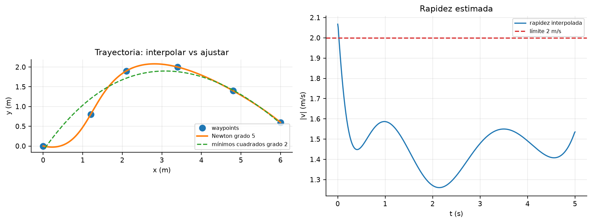

# Caso 02 — Trayectoria de un robot móvil

| ⬅️ Índice de casos | 🏠 Inicio |
|:---|:---:|
| [Casos de estudio](README.md) | [README](../../README.md) |



## 1. El problema

Un robot móvil debe pasar por seis waypoints registrados por el operador:

| $t$ (s) | 0 | 1 | 2 | 3 | 4 | 5 |
|---|---|---|---|---|---|---|
| $x$ (m) | 0.0 | 1.2 | 2.1 | 3.4 | 4.8 | 6.0 |
| $y$ (m) | 0.0 | 0.8 | 1.9 | 2.0 | 1.4 | 0.6 |

El controlador necesita una curva $x(t),y(t)$ y una estimación de la rapidez.
La restricción física es $|v|\le 2$ m/s.

## 2. ¿Interpolar o ajustar?

**Interpolar:** los waypoints son exactos, no mediciones con ruido. Pero no
basta con pasar por ellos: la trayectoria debe ser suave y no puede salirse del
pasillo ni exceder la rapidez. Ahí la elección del interpolante importa.

## 3. Método recomendado: trazador cúbico (`CubicSpline`)

Para una trayectoria real, el **trazador cúbico** es mejor que un polinomio
global de grado 5 porque:

- pasa exactamente por los waypoints;
- tiene primera y segunda derivada continuas (rapidez y aceleración suaves);
- no oscila entre puntos como el polinomio global (fenómeno de Runge);
- en estos datos, la rapidez máxima es **1.67 m/s**, dentro del límite, y no
  baja de $y=0$.

El **polinomio de Newton de grado 5** es el método del libro y se conserva para
explicar el mecanismo. En estos datos pasa por los waypoints, pero:

- la rapidez máxima sube a **2.07 m/s** (excede el límite);
- la curva baja a $y=-0.027$ m, un sobrepaso que el robot no debe hacer.

**Conclusión:** para el robot, el trazador cúbico es el método recomendado; el
polinomio de Newton es el método del libro que se estudia y se compara.

## 4. Otros métodos viables

| Método | ¿Pasa por los puntos? | Rapidez máx. | Cuándo conviene |
|---|---:|:---:|---|
| Lineal | Sí | Discontinua | Tramos rectos, sin suavidad |
| **CubicSpline** | **Sí** | **1.67 m/s** | **Trayectoria real del robot** |
| Newton grado 5 | Sí | 2.07 m/s | Estudio del método, datos exactos |
| Mínimos cuadrados grado 2 | No | Suave | Waypoints con ruido de GPS |

Si los waypoints vinieran de un GPS con error, el polinomio de grado 5
reproduciría el ruido; ahí conviene mínimos cuadrados (grado 2 o 3), aunque no
pase exactamente por los puntos.

## 5. Código

**Método del libro (Newton):**

```python
import numpy as np
from ajuste_curvas import newton

t  = np.array([0.0, 1.0, 2.0, 3.0, 4.0, 5.0])
xr = np.array([0.0, 1.2, 2.1, 3.4, 4.8, 6.0])
yr = np.array([0.0, 0.8, 1.9, 2.0, 1.4, 0.6])

tt = np.linspace(0, 5, 500)
px = newton(t, xr, tt)
py = newton(t, yr, tt)
v  = np.hypot(np.gradient(px, tt), np.gradient(py, tt))
print("rapidez máxima:", v.max())      # 2.0675 m/s
```

**Método recomendado (trazador cúbico):**

```python
from scipy.interpolate import CubicSpline

sx = CubicSpline(t, xr)
sy = CubicSpline(t, yr)
pxs, pys = sx(tt), sy(tt)
vs = np.hypot(np.gradient(pxs, tt), np.gradient(pys, tt))
print("rapidez máxima:", vs.max())     # 1.6683 m/s
```

## 6. Comparación con la librería

| Vía | Valor en $t=2.5$ (x) | Rapidez máx. | Observación |
|---|---:|---:|---|
| Newton grado 5 | 2.775 | 2.0675 | Global, puede oscilar |
| `CubicSpline` | 2.770 | 1.6683 | Por tramos, suave |
| `np.polyfit` grado 5 | 2.775 | 2.0675 | Mismo polinomio que Newton |

`np.polyfit` y Newton dan el mismo polinomio (distinta base); `CubicSpline` es
otro interpolante y por eso da otra curva. **No son intercambiables**: la
elección depende de si se prioriza el polinomio global o la suavidad local.

## 7. Verificación

| Comprobación | Newton | CubicSpline |
|---|---|---|
| Pasa por los waypoints | Sí | Sí |
| $y_{\min}$ | $-0.027$ m | $0.000$ m |
| Rapidez máxima | 2.0675 m/s | 1.6683 m/s |
| ¿Cumple $|v|\le2$? | **No** | **Sí** |

## 8. Lectura de la figura

- Izquierda: Newton (naranja) y el trazador (verde) pasan por los puntos, pero
  Newton se hunde ligeramente al inicio.
- Derecha: la rapidez de Newton cruza el límite de 2 m/s; la del trazador se
  queda por debajo. Esa es la razón práctica para recomendar el trazador.
