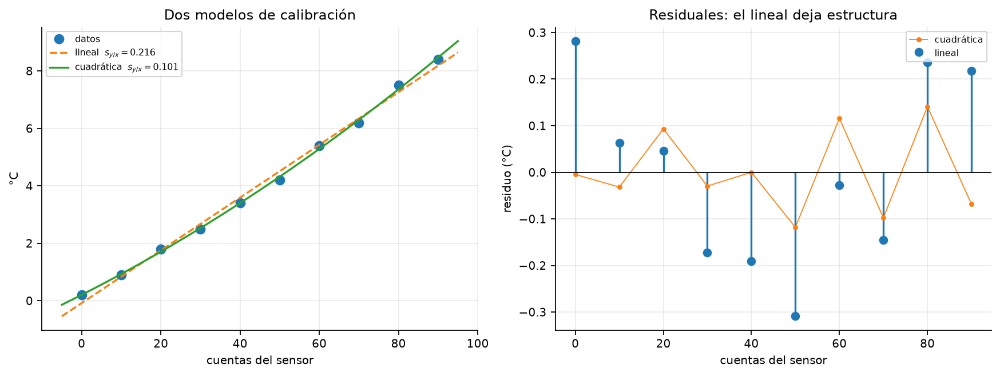
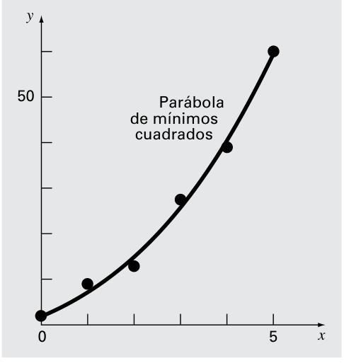

# Caso 03 — Calibración de un sensor

| ⬅️ Índice de casos | 🏠 Inicio |
|:---|:---:|
| [Casos de estudio](README.md) | [README](../../README.md) |



## 1. El problema

Un sensor entrega una lectura digital $x$ y se calibra contra un patrón de
temperatura $y$. El fabricante reporta un ruido de $\pm0.1$ °C.

| $x$ (cuentas) | 0 | 10 | 20 | 30 | 40 | 50 | 60 | 70 | 80 | 90 |
|---|---|---|---|---|---|---|---|---|---|---|
| $y$ (°C) | 0.2 | 0.9 | 1.8 | 2.5 | 3.4 | 4.2 | 5.4 | 6.2 | 7.5 | 8.4 |

No se quiere pasar por los puntos: se quiere la **tendencia** y un modelo
defendible.

## 2. ¿Interpolar o ajustar?

**Ajustar.** Hay 10 mediciones con ruido; interpolar con un polinomio de grado
9 copiaría el ruido y daría una calibración inestable. Se comparan modelos de
grado 1 y 2.

## 3. Método recomendado: mínimos cuadrados cuadráticos

El modelo lineal deja $s_{y/x}=0.216$ °C, **por encima** del ruido de 0.1 °C, y
sus residuales muestran una curvatura sistemática. El cuadrático baja a
$s_{y/x}=0.102$ °C, del orden del ruido, y su coeficiente $x^2$ es estable al
quitar un punto.

Por eso el modelo recomendado es

$$y=0.2045+0.0703x+2.39\times10^{-4}x^2.$$

**No se sube a grado 3:** su $s_{y/x}$ ajustado es 0.109 °C, peor que el
cuadrático, y el término cúbico no tiene justificación física.

## 4. Otros métodos viables

| Modelo | $s_{y/x}$ (°C) | $r^2$ | Decisión |
|---|---:|---:|---|
| Lineal | 0.2158 | 0.99467 | Insuficiente: deja estructura |
| **Cuadrático** | **0.1015** | **0.99897** | **Recomendado** |
| Cúbico | 0.1094 | 0.99897 | No mejora; no se justifica |
| Interpolación grado 9 | 0 | 1 | Sobreajuste; no usar |

## 5. Código

```python
import numpy as np
from ajuste_curvas import minimos_cuadrados

x = np.arange(0, 100, 10, dtype=float)
y = np.array([0.2, 0.9, 1.8, 2.5, 3.4, 4.2, 5.4, 6.2, 7.5, 8.4])

r = minimos_cuadrados(x, y, 2)
print(r["coef"])       # [0.204545, 0.070341, 0.000239]
print(r["syx"], r["r2"])
```

Con la sintaxis matricial del curso, las ecuaciones normales (17.19) se
escriben y resuelven así:

```python
n = len(x)
A = M.sym[[n, sum(x), sum(x**2)],
          [sum(x), sum(x**2), sum(x**3)],
          [sum(x**2), sum(x**3), sum(x**4)]]
b = M.sym[[sum(y)], [sum(x * y)], [sum(x**2 * y)]]
mostrar(A)
mostrar(A.LUsolve(b))
```

## 6. Comparación con la librería

```python
coef = np.polyfit(x, y, 2)          # [2.39e-4, 0.0703, 0.2045]
```

`np.polyfit` devuelve los coeficientes en orden **descendente**
($a_2,a_1,a_0$); `minimos_cuadrados` los devuelve en orden **ascendente**
($a_0,a_1,a_2$). Los valores coinciden. La diferencia es de convención, no de
método.

## 7. Verificación

| Comprobación | Resultado |
|---|---|
| Residual medio | $\approx0$ |
| $s_{y/x}$ cuadrático | 0.1015 °C, comparable al ruido 0.1 °C |
| Coeficientes estables al quitar un punto | cambio máximo 0.023 |
| Lineal vs cuadrático | el lineal deja curvatura en los residuales |

## 8. Lectura de la figura



*Figura 17.11. El libro muestra la misma idea con sus datos del ejemplo 17.5: la parábola sigue la tendencia sin pasar por todos los puntos.*

- Izquierda: el modelo lineal se despega en los extremos; el cuadrático sigue
  la curvatura suave de los datos.
- Derecha: los residuales del lineal forman una parábola (estructura
  sistemática); los del cuadrático se reparten alrededor de cero. Esa es la
  evidencia de que el término $x^2$ está justificado.
