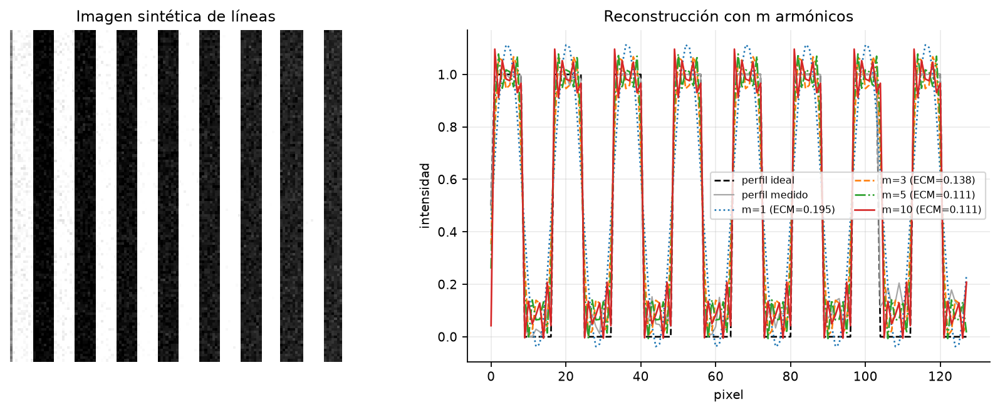
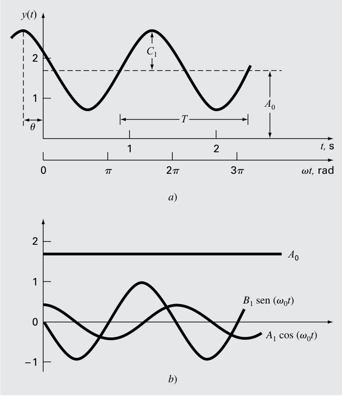

# Caso 04 — Imagen de líneas con series de Fourier

| ⬅️ Índice de casos | 🏠 Inicio |
|:---|:---:|
| [Casos de estudio](README.md) | [README](../../README.md) |



## 1. El problema

Una cámara industrial mira una pieza con franjas verticales. Se toma la fila
central de una imagen de $128$ píxeles y se quiere:

1. representar el perfil de intensidad con **pocos** armónicos;
2. reconstruirlo para localizar los bordes claro/oscuro;
3. decidir cuántos armónicos son suficientes.

La imagen sintética tiene periodo de 16 píxeles, un gradiente suave y ruido.

## 2. ¿Interpolar o ajustar?

**Ajustar con una base trigonométrica.** El perfil es periódico y ruidoso; un
polinomio que pase por los 128 píxeles copiaría el ruido y oscilaría. La serie
de Fourier es el modelo natural para una señal periódica: es regresión, no
interpolación.

## 3. Método recomendado: serie de Fourier con $m=5$

Con la frecuencia fundamental $\omega_0=2\pi/16$, la serie

$$f(x)=A_0+\sum_{j=1}^{m}\left[A_j\cos(j\omega_0x)+B_j\sin(j\omega_0x)\right]$$

se ajusta con las ecuaciones (19.14)–(19.16). El ECM de reconstrucción es:

| $m$ | ECM |
|---:|---:|
| 1 | 0.1950 |
| 3 | 0.1385 |
| **5** | **0.1112** |
| 10 | 0.1112 |

**Recomendación: $m=5$.** Captura la fundamental y los armónicos impares que
forman los flancos de la onda cuadrada. Pasar a $m=10$ no mejora el ECM porque
los armónicos pares de esta señal son casi cero; sólo agrega coeficientes que
pueden empezar a seguir el ruido.

## 4. Otros métodos viables

| Método | Ventaja | Limitación |
|---|---|---|
| $m=1$ | Modelo mínimo, 3 coeficientes | No reproduce los flancos |
| $m=3$ | Buen compromiso | Flancos todavía redondeados |
| **$m=5$** | **ECM 0.111, 11 coeficientes** | **Recomendado** |
| $m=10$ | Ninguna mejora aquí | Más coeficientes, más riesgo de ruido |
| Interpolación polinomial | Pasa por todos los píxeles | Oscila y copia el ruido |

## 5. Código

```python
import numpy as np
from ajuste_curvas import coeficientes_fourier, evaluar_fourier

N, periodo = 128, 16
omega0 = 2 * np.pi / periodo
t = np.arange(N, dtype=float)

# perfil: fila central de la imagen
coef = coeficientes_fourier(t, perfil, omega0, 5)
recon = evaluar_fourier(t, coef, omega0)

ecm = np.sqrt(np.mean((recon - perfil) ** 2))
print(ecm)          # 0.1112
```

## 6. Comparación con la librería

La FFT calcula las mismas frecuencias de forma eficiente:

```python
espectro = np.fft.rfft(perfil - perfil.mean()) / N
frecuencias = np.fft.rfftfreq(N, d=1.0)

k = np.argmax(np.abs(espectro[1:])) + 1
print("armónico dominante:", k)          # 8 -> periodo 16
```

La FFT entrega todos los armónicos de golpe; la serie de Fourier con
`coeficientes_fourier` permite elegir $m$ y conserva la forma coseno/seno del
libro. Para $N=128$ los resultados coinciden; la FFT es la versión eficiente
(sección 19.6 del libro).

## 7. Verificación

| Comprobación | Resultado |
|---|---|
| Periodo estimado por FFT | 16 píxeles |
| ECM con $m=1,3,5$ | 0.1950 → 0.1385 → 0.1112 |
| Bordes detectados | 8, 16, …, 120 (el borde en 0 es el límite de la ventana) |
| Perfil reconstruido | sigue los flancos sin copiar el ruido |

## 8. Lectura de la figura



*Figura 19.3. Los cuatro parámetros de la sinusoide: valor medio, amplitud, periodo y fase.*

- Izquierda: la imagen tiene franjas negras y blancas con un gradiente de
  iluminación y ruido.
- Derecha: con $m=1$ sólo se ve la onda fundamental; con $m=3$ y $m=5$
  aparecen los flancos. Las curvas de $m=5$ y $m=10$ se superponen: no vale la
  pena agregar más armónicos.
