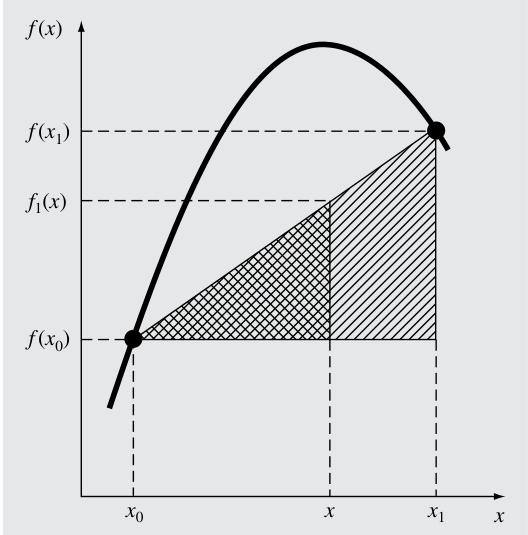
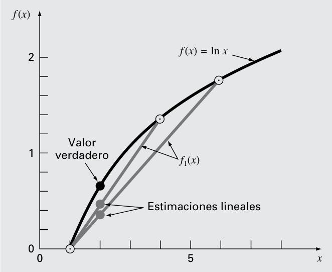
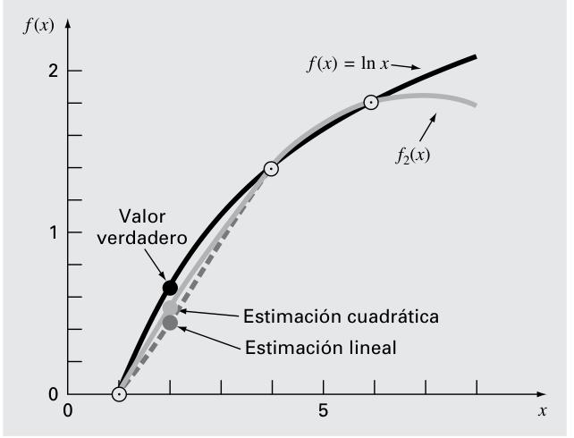

# Interpolación Lineal y Cuadrática

| 🏠 Inicio | Siguiente ➡️ |
|:---:|---:|
| [README](../../README.md) | [Newton en diferencias divididas](02_newton_diferencias_divididas.md) |

> **Tema 4.1 del programa.** Contenido basado en el capítulo 5 del libro
> (*Ajuste de curvas*), secciones 18.1.1 y 18.1.2, y en los antecedentes
> PT5.1–PT5.3. Las extensiones computacionales se marcan como tales.

## 📑 Índice

1. [Interpolar no es ajustar](#sec-1)
2. [Interpolación lineal](#sec-2)
3. [Interpolación cuadrática](#sec-3)
4. [Error de la interpolación](#sec-4)
5. [Cómo elegir los nodos](#sec-5)
6. [Implementación y verificación](#sec-6)

---

### <a id="sec-1"></a>1. Interpolar no es ajustar

**📘 Teoría.** Interpolar es construir una función que **pase exactamente** por
un conjunto de puntos $(x_0,y_0),\dots,(x_n,y_n)$. Ajustar (tema 4.3) es
construir una función que pase **cerca** de todos ellos, sin exigir que los
toque. La diferencia no es cosmética:

| | Interpolación | Regresión |
|---|---|---|
| ¿Pasa por los datos? | Sí, por construcción | No necesariamente |
| Uso típico | Datos exactos, tablas, trayectorias | Datos con ruido de medición |
| Riesgo | Amplifica el ruido y oscila | Suaviza de más |
| Número de coeficientes | $n+1$ para $n+1$ puntos | Menor que el número de datos |

El libro lo plantea en PT5.3: cuando los datos son escasos pero confiables
(tablas de vapor, coordenadas de una trayectoria), se interpola; cuando hay
muchas mediciones con error, se ajusta.

**🧮 Ejemplo algebraico.** Dos puntos definen una recta; tres puntos definen
una parábola. Ese es todo el principio: el polinomio de grado $n$ que pasa por
$n+1$ puntos con abscisas distintas es **único**.

---

### <a id="sec-2"></a>2. Interpolación lineal

Es unir dos puntos con una recta. Por triángulos semejantes
(figura 18.2 del libro),

$$\frac{f_1(x)-f(x_0)}{x-x_0}=\frac{f(x_1)-f(x_0)}{x_1-x_0},$$

y al despejar se obtiene la fórmula de interpolación lineal,

$$f_1(x)=f(x_0)+\frac{f(x_1)-f(x_0)}{x_1-x_0}(x-x_0).$$

El cociente $[f(x_1)-f(x_0)]/(x_1-x_0)$ es la pendiente de la recta y, además,
una aproximación en diferencias divididas finitas a la primera derivada.



*Figura 18.2. Los triángulos semejantes de la figura justifican la fórmula (18.2).*

**🧮 Ejemplo 18.1 del libro — estimar $\ln 2$.** Con
$x_0=1,\ f(x_0)=\ln 1=0$ y $x_1=6,\ f(x_1)=\ln 6=1.791759$:

$$f_1(2)=0+\frac{1.791759-0}{6-1}(2-1)=0.3583519,$$

error relativo $48.3\%$ porque el valor verdadero es $\ln 2=0.6931472$.
Con el intervalo más corto $x_0=1$ a $x_1=4$:

$$f_1(2)=0+\frac{1.386294-0}{4-1}(2-1)=0.4620981,$$

error relativo $33.3\%$. **Lección:** al reducir el intervalo, la recta
representa mejor a una función suave.



*Figura 18.3. El intervalo más corto acerca la recta a la curva y reduce el error.*

**🔢 Versión paso a paso.**

1. Identifica el intervalo $[x_0,x_1]$ que contiene a $x$.
2. Calcula la pendiente $m=\dfrac{y_1-y_0}{x_1-x_0}$.
3. Evalúa $y=y_0+m(x-x_0)$.
4. Estima el error con la ecuación (18.17) si tienes un punto extra, o
   compáralo contra el valor verdadero si lo conoces.

**💻 Implementación.** En el cuaderno y en `lib/ajuste_curvas.py`:

```python
from ajuste_curvas import newton
newton([1.0, 6.0], [0.0, 1.791759], 2.0)   # 0.3583519
```

---

### <a id="sec-3"></a>3. Interpolación cuadrática

**📘 Teoría.** Con tres puntos se ajusta el único polinomio de segundo grado
que pasa por ellos. La forma conveniente —y base del método de Newton— es

$$f_2(x)=b_0+b_1(x-x_0)+b_2(x-x_0)(x-x_1). \tag{18.3}$$

Aunque parece distinta del polinomio general $a_0+a_1x+a_2x^2$, es equivalente.
Los coeficientes se obtienen por evaluación sucesiva:

$$b_0=f(x_0), \tag{18.4}$$

$$b_1=\frac{f(x_1)-f(x_0)}{x_1-x_0}, \tag{18.5}$$

$$b_2=\frac{\dfrac{f(x_2)-f(x_1)}{x_2-x_1}-\dfrac{f(x_1)-f(x_0)}{x_1-x_0}}{x_2-x_0}. \tag{18.6}$$

Los dos primeros términos son la interpolación lineal de $x_0$ a $x_1$; el
término $b_2(x-x_0)(x-x_1)$ aporta la curvatura.

**🧮 Ejemplo 18.2 del libro.** Con los tres puntos del ejemplo anterior
$x_0=1,\ x_1=4,\ x_2=6$:

$$b_0=0,\qquad b_1=\frac{1.386294-0}{4-1}=0.4620981,$$

$$b_2=\frac{\dfrac{1.791759-1.386294}{6-4}-0.4620981}{6-1}=-0.0518731,$$

$$f_2(x)=0+0.4620981(x-1)-0.0518731(x-1)(x-4).$$

Evaluando en $x=2$:

$$f_2(2)=0.5658444,$$

error relativo $18.4\%$: la curvatura mejoró la estimación lineal.



*Figura 18.4. La parábola corrige la curvatura que la recta no puede seguir.*

**🔢 Versión paso a paso.**

1. Ordena los tres nodos como $x_0,x_1,x_2$.
2. Calcula $b_0=y_0$.
3. Calcula $b_1=(y_1-y_0)/(x_1-x_0)$.
4. Calcula $b_2$ con la ecuación (18.6); equivale a la segunda diferencia
   dividida $f[x_2,x_1,x_0]$.
5. Evalúa $f_2$ en el punto de interés.

**💻 Implementación.**

```python
from ajuste_curvas import coeficientes_newton, evaluar_newton
x = [1.0, 4.0, 6.0]
y = [0.0, 1.386294, 1.791759]
b = coeficientes_newton(x, y)
evaluar_newton(x, b, 2.0)      # 0.5658444
```

---

### <a id="sec-4"></a>4. Error de la interpolación

**📘 Teoría.** Para un polinomio de grado $n$ basado en $n+1$ puntos, el error
de truncamiento es análogo al de Taylor:

$$R_n=\frac{f^{(n+1)}(\xi)}{(n+1)!}(x-x_0)(x-x_1)\cdots(x-x_n), \tag{18.16}$$

con $\xi$ en el intervalo que contiene a $x$ y a los datos. Si no se conoce
$f$, se usa la formulación con diferencias divididas:

$$R_n=f[x,x_n,x_{n-1},\dots,x_0]\prod_{i=0}^{n}(x-x_i). \tag{18.17}$$

Cuando se tiene **un punto extra** $x_{n+1}$, el error se estima como

$$R_n\cong f[x_{n+1},x_n,\dots,x_0]\prod_{i=0}^{n}(x-x_i), \tag{18.18}$$

que es la diferencia entre la predicción de grado $n+1$ y la de grado $n$:

$$R_n=f_{n+1}(x)-f_n(x). \tag{18.19}$$

**🧮 Ejemplo 18.4 del libro.** Para la cuadrática del ejemplo 18.2 y el punto
extra $x_3=5,\ f(5)=1.609438$:

$$R_2=f[x_3,x_2,x_1,x_0](x-1)(x-4)(x-6)
=0.007865529(2-1)(2-4)(2-6)=0.0629242.$$

El error verdadero fue $0.6931472-0.5658444=0.1273028$: el estimado es del
mismo orden de magnitud.

**⚠️ Advertencia.** El error depende del producto $\prod(x-x_i)$: si el punto
está lejos de los nodos, el producto crece y la extrapolación se dispara. Los
nodos deben **rodear** a $x$ y estar cerca de él.

---

### <a id="sec-5"></a>5. Cómo elegir los nodos

**📘 Teoría.** El libro insiste en dos ideas al comparar grados:

1. **Más grado no siempre es mejor.** Al agregar nodos se reduce el error si
   los puntos están bien colocados; si están mal, el polinomio oscila y el
   error crece (fenómeno de Runge, mencionado en el capítulo como mal
   condicionamiento de los polinomios de grado alto).
2. **La posición importa.** Los puntos deben estar centrados alrededor de la
   incógnita y, de preferencia, a ambos lados de ella. El ejemplo 18.5 muestra
   que invertir el orden de los mismos datos cambia la velocidad de
   convergencia.

**🔢 Regla práctica.**

| Situación | Decisión |
|---|---|
| $x$ dentro del intervalo de los datos y nodos cercanos | Sube de grado hasta que el error estimado se estabilice |
| $x$ fuera del intervalo | No extrapoles con polinomios de grado alto; usa un modelo físico o regresión |
| Datos con ruido | Interpola poco; prefiere mínimos cuadrados (tema 4.3) |
| Muchos nodos | Considera trazadores (splines), fuera del alcance de esta unidad |

---

### <a id="sec-6"></a>6. Implementación y verificación

**💻 Funciones de la unidad.**

| Función | Qué hace |
|---|---|
| `newton(x, y, xx)` | Coeficientes y evaluación del polinomio de Newton |
| `coeficientes_newton(x, y)` | Vector $b_0,\dots,b_n$ |
| `evaluar_newton(x, coef, xx)` | Horner sobre la forma (18.7) |
| `evaluar_lagrange(x, y, xx)` | Forma de Lagrange (18.20) |

**✅ Verificación mínima.**

```python
import numpy as np
from ajuste_curvas import newton
x = np.array([1.0, 4.0, 6.0])
y = np.array([0.0, 1.386294, 1.791759])
assert abs(newton(x, y, x[0]) - y[0]) < 1e-12   # pasa por el nodo
assert abs(newton(x, y, 2.0) - 0.5658444) < 1e-6
```

**⚠️ Errores comunes.**

- Usar nodos repetidos: la diferencia dividida divide entre cero.
- Confundir interpolación con extrapolación y reportar el resultado como si
  tuviera la misma confianza.
- Comparar grados sin graficar: un $r^2$ alto no prueba que la forma sea la
  correcta.
