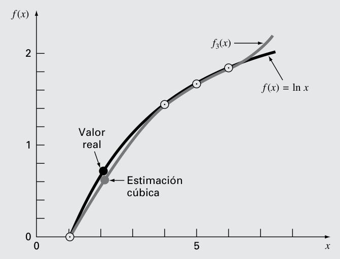

# Polinomios de Newton en Diferencias Divididas

| ⬅️ Anterior | 🏠 Inicio | Siguiente ➡️ |
|:---|:---:|---:|
| [Interpolación lineal y cuadrática](01_interpolacion_lineal_cuadratica.md) | [README](../../README.md) | [Polinomios de Lagrange](03_lagrange.md) |

> **Tema 4.2 del programa.** Contenido basado en la sección 18.1 del libro
> (ecuaciones 18.7–18.19). La implementación en Python es una extensión
> didáctica.

## 📑 Índice

1. [Forma general](#sec-1)
2. [Diferencias divididas](#sec-2)
3. [Ejemplo 18.3](#sec-3)
4. [Error y orden de los nodos](#sec-4)
5. [Algoritmo computacional](#sec-5)
6. [Implementación y verificación](#sec-6)

---

### <a id="sec-1"></a>1. Forma general

**📘 Teoría.** El polinomio de grado $n$ que pasa por $n+1$ puntos se escribe
en la forma anidada de Newton:

$$\begin{aligned}
f_n(x)={}&b_0+b_1(x-x_0)+b_2(x-x_0)(x-x_1)+\cdots\\
&+b_n(x-x_0)(x-x_1)\cdots(x-x_{n-1}).
\end{aligned} \tag{18.7}$$

Los coeficientes son las **diferencias divididas** evaluadas en los nodos:

$$\begin{aligned}
b_0=&f(x_0),\\
b_1=&f[x_1,x_0],\\
b_2=&f[x_2,x_1,x_0],\\
\dots,\\ 
b_n=&f[x_n,x_{n-1},\dots,x_0].
\end{aligned}
\tag{18.8–18.11}$$

La ventaja frente a la forma monomial $a_0+a_1x+\cdots+a_nx^n$ es que agregar
un nodo solo agrega **un término**; no hay que resolver un sistema ni
recalcular todo.

---

### <a id="sec-2"></a>2. Diferencias divididas

**📘 Teoría.** La primera diferencia dividida es una pendiente:

$$f[x_i,x_j]=\frac{f(x_i)-f(x_j)}{x_i-x_j}. \tag{18.12}$$

La segunda es la diferencia de dos primeras diferencias:

$$f[x_i,x_j,x_k]=\frac{f[x_i,x_j]-f[x_j,x_k]}{x_i-x_k}. \tag{18.13}$$

En general,

$$f[x_n,x_{n-1},\dots,x_0]=
\frac{f[x_n,x_{n-1},\dots,x_1]-f[x_{n-1},\dots,x_0]}{x_n-x_0}. \tag{18.14}$$

La estructura es recursiva y se organiza en una tabla triangular (figura 18.5
del libro):

| $i$ | $x_i$ | $f(x_i)$ | Primera | Segunda | Tercera |
|---|---|---|---|---|---|
| 0 | $x_0$ | $f(x_0)$ | $f[x_1,x_0]$ | $f[x_2,x_1,x_0]$ | $f[x_3,x_2,x_1,x_0]$ |
| 1 | $x_1$ | $f(x_1)$ | $f[x_2,x_1]$ | $f[x_3,x_2,x_1]$ | |
| 2 | $x_2$ | $f(x_2)$ | $f[x_3,x_2]$ | | |
| 3 | $x_3$ | $f(x_3)$ | | | |

Los coeficientes del polinomio son la **diagonal** de la tabla. No se exige
que los nodos estén igualmente espaciados ni en orden ascendente.

**🧮 Ejemplo algebraico.** Con tres nodos, la tabla es

$$\begin{array}{c|ccc}
x_0 & f(x_0) & &\\
x_1 & f(x_1) & f[x_1,x_0] &\\
x_2 & f(x_2) & f[x_2,x_1] & f[x_2,x_1,x_0]
\end{array}$$

y el polinomio es $b_0+b_1(x-x_0)+b_2(x-x_0)(x-x_1)$.

---

### <a id="sec-3"></a>3. Ejemplo 18.3

**🧮 Datos del libro.** Se agrega $x_3=5,\ f(x_3)=1.609438$ a los puntos
$x_0=1,\ x_1=4,\ x_2=6$ de los ejemplos 18.1 y 18.2.

Primeras diferencias:

$$f[x_1,x_0]=\frac{1.386294-0}{4-1}=0.4620981,$$

$$f[x_2,x_1]=\frac{1.791759-1.386294}{6-4}=0.2027326,$$

$$f[x_3,x_2]=\frac{1.609438-1.791759}{5-6}=0.1823216.$$

Segundas diferencias:

$$f[x_2,x_1,x_0]=\frac{0.2027326-0.4620981}{6-1}=-0.05187311,$$

$$f[x_3,x_2,x_1]=\frac{0.1823216-0.2027326}{5-4}=-0.02041100.$$

Tercera diferencia:

$$f[x_3,x_2,x_1,x_0]=\frac{-0.02041100-(-0.05187311)}{5-1}=0.007865529.$$

Por lo tanto,

$$\begin{aligned}
f_3(x)={}&0+0.4620981(x-1)-0.05187311(x-1)(x-4)\\
&+0.007865529(x-1)(x-4)(x-6),
\end{aligned}$$

y en $x=2$:

$$f_3(2)=0.6287686,\qquad \varepsilon_t=9.3\%.$$



*Figura 18.6. La cúbica sigue mejor la curva, aunque ya empieza a separarse en el extremo derecho: más grado no siempre es mejor.*

**🔢 Lectura del resultado.** Cada término nuevo reduce el error:
$48.3\%\to33.3\%\to18.4\%\to9.3\%$. Esa es la razón por la que Newton es
atractivo para explorar grados sucesivos.

---

### <a id="sec-4"></a>4. Error y orden de los nodos

**📘 Teoría.** El error de truncamiento es el de la ecuación (18.16),

$$R_n=\frac{f^{(n+1)}(\xi)}{(n+1)!}\prod_{i=0}^{n}(x-x_i),$$

y su estimación práctica con un punto extra es

$$R_n\cong f[x_{n+1},x_n,\dots,x_0]\prod_{i=0}^{n}(x-x_i). \tag{18.18}$$

Equivalentemente, el término que se agrega al pasar de grado $n$ a $n+1$ es
una estimación del error de grado $n$:

$$R_n=f_{n+1}(x)-f_n(x). \tag{18.19}$$

**🔢 Ejemplo 18.4 del libro.**

$$R_2=0.007865529(2-1)(2-4)(2-6)=0.0629242,$$

frente al error verdadero $0.1273028$.

**⚠️ Qué controla el error.** Como $R_n$ es proporcional al producto
$\prod(x-x_i)$:

- nodos cerca de $x$ → producto pequeño → error pequeño;
- $x$ fuera del rango de los nodos → producto grande → extrapolación peligrosa;
- nodos a ambos lados de $x$ → mejor comportamiento que nodos todos de un lado.

El ejemplo 18.5 del libro demuestra que, con los **mismos** datos en orden
distinto, el error de segundo grado puede bajar de $18.4\%$ a menos de $2\%$.

---

### <a id="sec-5"></a>5. Algoritmo computacional

**📘 Teoría.** El pseudocódigo del libro (figura 18.7) calcula la tabla y
evalúa todos los grados de una vez:

```text
SUB Newtint(x, y, n, xi, yint, ea)
  DOFOR i = 0, n
    fdd(i, 0) = y(i)
  END DO
  DOFOR j = 1, n
    DOFOR i = j, n
      fdd(i, j) = (fdd(i, j-1) - fdd(i-1, j-1)) / (x(i) - x(i-j))
    END DO
  END DO

  xterm = 1
  yint(0) = fdd(0, 0)
  DOFOR order = 1, n
    xterm = xterm * (xi - x(order-1))
    yint(order) = yint(order-1) + fdd(order, order) * xterm
    ea(order-1) = yint(order) - yint(order-1)
  END DO
END Newtint
```

El costo es $O(n^2)$ para la tabla y $O(n)$ para cada evaluación.

**💻 Implementación en la unidad.**

```python
from ajuste_curvas import tabla_diferencias, coeficientes_newton, evaluar_newton

tabla = tabla_diferencias(x, y)     # tabla triangular completa
b = coeficientes_newton(x, y)       # diagonal = coeficientes
f3 = evaluar_newton(x, b, 2.0)      # Horner
```

`evaluar_newton` usa Horner, así que no recalcula productos desde cero:

$$p=b_n;\qquad p\leftarrow p(x-x_k)+b_k,\quad k=n-1,\dots,0.$$

---

### <a id="sec-6"></a>6. Implementación y verificación

**✅ Verificación.**

```python
import numpy as np
from ajuste_curvas import coeficientes_newton, evaluar_newton

x = np.array([1.0, 4.0, 6.0, 5.0])
y = np.array([0.0, 1.386294, 1.791759, 1.609438])
b = coeficientes_newton(x, y)
assert np.allclose(b, [0, 0.4620981, -0.0518731, 0.007865529], atol=1e-6)
assert abs(evaluar_newton(x, b, 2.0) - 0.6287686) < 1e-5
```

**⚠️ Errores comunes.**

- Leer la tabla por columnas cuando los coeficientes están en la diagonal.
- Suponer que más nodos siempre mejora: depende de dónde estén.
- Usar la ecuación (18.18) como criterio de paro absoluto: el libro advierte
  que puede **subestimar** el error en series de convergencia rápida.
- Confundir el orden de los nodos en la notación $f[x_i,x_j]$: la diferencia
  dividida es simétrica, pero la tabla recursiva no lo es.
