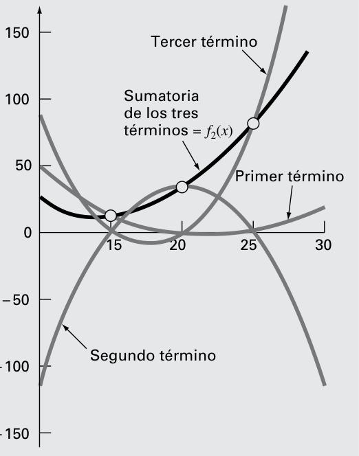

# Polinomios de Interpolación de Lagrange

| ⬅️ Anterior | 🏠 Inicio | Siguiente ➡️ |
|:---|:---:|---:|
| [Newton en diferencias divididas](02_newton_diferencias_divididas.md) | [README](../../README.md) | [Mínimos cuadrados](04_minimos_cuadrados_lineal_cuadratico.md) |

> **Tema 4.2 del programa.** Contenido basado en la sección 18.2 del libro
> (ecuaciones 18.20–18.23 y cuadro 18.1).

## 📑 Índice

1. [La idea: pesos que aíslan cada nodo](#sec-1)
2. [Fórmulas lineal y cuadrática](#sec-2)
3. [Ejemplo 18.6](#sec-3)
4. [Newton contra Lagrange](#sec-4)
5. [Implementación y verificación](#sec-5)

---

### <a id="sec-1"></a>1. La idea: pesos que aíslan cada nodo

**📘 Teoría.** El polinomio de Lagrange es una **reformulación** del polinomio
de Newton que evita calcular diferencias divididas:

$$f_n(x)=\sum_{i=0}^{n}L_i(x)\,f(x_i), \tag{18.20}$$

donde cada peso es un producto de cocientes:

$$L_i(x)=\prod_{\substack{j=0\\ j\neq i}}^{n}\frac{x-x_j}{x_i-x_j}. \tag{18.21}$$

La propiedad clave es inmediata: $L_i(x_i)=1$ porque todos los factores valen
$x_i-x_i$ sobre sí mismos, y $L_i(x_j)=0$ para $j\neq i$ porque uno de los
factores del numerador es $x_j-x_j=0$. Por eso cada término
$L_i(x)f(x_i)$ vale $f(x_i)$ en su nodo y cero en los demás; la suma reproduce
exactamente los $n+1$ datos.



*Figura 18.10. Cada peso $L_i(x)$ vale 1 en su nodo y 0 en los demás; la suma de los tres términos es el polinomio $f_2(x)$.*

**🧮 Ejemplo algebraico.** Con dos nodos, los pesos son

$$L_0(x)=\frac{x-x_1}{x_0-x_1},\qquad L_1(x)=\frac{x-x_0}{x_1-x_0}.$$

En $x=x_0$: $L_0=1$ y $L_1=0$. En $x=x_1$: $L_0=0$ y $L_1=1$.

---

### <a id="sec-2"></a>2. Fórmulas lineal y cuadrática

**📘 Teoría.** Para $n=1$ la ecuación (18.21) da

$$f_1(x)=\frac{x-x_1}{x_0-x_1}f(x_0)+\frac{x-x_0}{x_1-x_0}f(x_1). \tag{18.22}$$

Para $n=2$:

$$\begin{aligned}
f_2(x)={}&\frac{(x-x_1)(x-x_2)}{(x_0-x_1)(x_0-x_2)}f(x_0)
+\frac{(x-x_0)(x-x_2)}{(x_1-x_0)(x_1-x_2)}f(x_1)\\
&+\frac{(x-x_0)(x-x_1)}{(x_2-x_0)(x_2-x_1)}f(x_2).
\end{aligned} \tag{18.23}$$

El cuadro 18.1 del libro muestra que la forma de Lagrange sale directamente de
reescribir la primera diferencia dividida en forma simétrica:

$$f[x_1,x_0]=\frac{f(x_1)}{x_1-x_0}+\frac{f(x_0)}{x_0-x_1}.$$

Sustituyendo en la fórmula lineal de Newton y agrupando se recupera la
ecuación (18.22).

---

### <a id="sec-3"></a>3. Ejemplo 18.6

**🧮 Datos del libro.** Estimar $\ln 2$ con los puntos
$x_0=1,\ x_1=4,\ x_2=6$ y
$f(x_0)=0,\ f(x_1)=1.386294,\ f(x_2)=1.791760$.

**Primer grado** (ecuación 18.22) evaluado en $x=2$:

$$f_1(2)=\frac{2-4}{1-4}(0)+\frac{2-1}{4-1}(1.386294)=0.4620981.$$

**Segundo grado** (ecuación 18.23) en $x=2$:

$$\begin{aligned}
f_2(2)={}&\frac{(2-4)(2-6)}{(1-4)(1-6)}(0)
+\frac{(2-1)(2-6)}{(4-1)(4-6)}(1.386294)\\
&+\frac{(2-1)(2-4)}{(6-1)(6-4)}(1.791760)=0.5658444.
\end{aligned}$$

Ambos resultados coinciden con los de Newton: **el polinomio es el mismo**, sólo
cambia la forma de escribirlo.

**🔢 Verificación de los pesos.** En $x=2$:

| $i$ | $L_i(2)$ | $L_i(2)f(x_i)$ |
|---|---|---|
| 0 | $\dfrac{(2-4)(2-6)}{(1-4)(1-6)}=0.5333$ | $0$ |
| 1 | $\dfrac{(2-1)(2-6)}{(4-1)(4-6)}=0.6667$ | $0.924196$ |
| 2 | $\dfrac{(2-1)(2-4)}{(6-1)(6-4)}=-0.2000$ | $-0.358352$ |
| $\sum$ | $1.0000$ | $0.565844$ |

Los pesos suman 1: es la garantía de que el polinomio reproduce una constante.

---

### <a id="sec-4"></a>4. Newton contra Lagrange

**📘 Teoría.** El libro cierra la sección con una comparación honesta:

| Criterio | Newton | Lagrange |
|---|---|---|
| Cálculo previo | Tabla de diferencias divididas $O(n^2)$ | Ninguno |
| Agregar un nodo | Sólo se agrega un término | Hay que recalcular todos los pesos |
| Estimación del error | Directa con (18.18) | Requiere diferencias divididas, que no se calculan |
| Programación | Ligeramente más larga | Muy corta (dos ciclos) |
| Uso recomendado | Explorar grados y estimar error | Una sola interpolación de grado fijo |

Para **una sola** interpolación el trabajo computacional es semejante. Para
**varias** interpolaciones sobre los mismos nodos, Newton gana porque la tabla
se reutiliza.

**⚠️ Nota sobre el grado.** Ninguna de las dos formas escapa al mal
condicionamiento de los polinomios de grado alto: con muchos nodos, pequeños
errores en los datos producen oscilaciones grandes. El libro lo advierte al
discutir el error; la solución práctica son los trazadores (splines), que
quedan fuera del alcance de esta unidad.

---

### <a id="sec-5"></a>5. Implementación y verificación

**💻 Implementación.** La ecuación (18.21) se programa con dos ciclos:

```python
from ajuste_curvas import evaluar_lagrange

x = [1.0, 4.0, 6.0]
y = [0.0, 1.386294, 1.791760]
evaluar_lagrange(x, y, 2.0)     # 0.5658444
```

Pseudocódigo del libro (figura 18.11):

```text
FUNCTION Lagrng(x, y, n, xx)
  sum = 0
  DOFOR i = 0, n
    product = y(i)
    DOFOR j = 0, n
      IF i != j THEN
        product = product * (xx - x(j)) / (x(i) - x(j))
      ENDIF
    END DO
    sum = sum + product
  END DO
  Lagrng = sum
END Lagrng
```

**✅ Verificación.**

1. El polinomio debe pasar por los nodos: `evaluar_lagrange(x, y, x) == y`.
2. Debe coincidir con Newton en cualquier punto del intervalo.
3. Los pesos $L_i$ deben sumar 1 en todo $x$.

```python
import numpy as np
from ajuste_curvas import evaluar_lagrange, newton

x = np.array([1.0, 4.0, 6.0])
y = np.array([0.0, 1.386294, 1.791760])
xx = np.linspace(0.5, 7.0, 50)
assert np.allclose(evaluar_lagrange(x, y, xx), newton(x, y, xx), atol=1e-9)
assert abs(evaluar_lagrange(x, y, 2.0) - 0.5658444) < 1e-6
```

**⚠️ Errores comunes.**

- Dividir entre cero cuando hay dos abscisas repetidas.
- Creer que Lagrange y Newton dan polinomios distintos: son el mismo,
  expresado de otra forma.
- Usar Lagrange para extrapolar con muchos nodos y confiar en el resultado.
