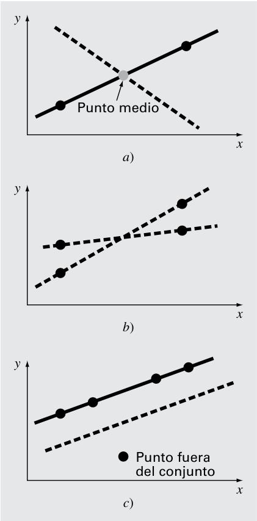
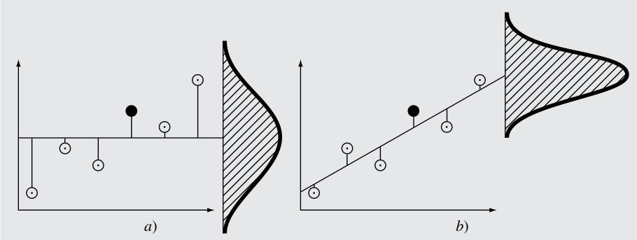
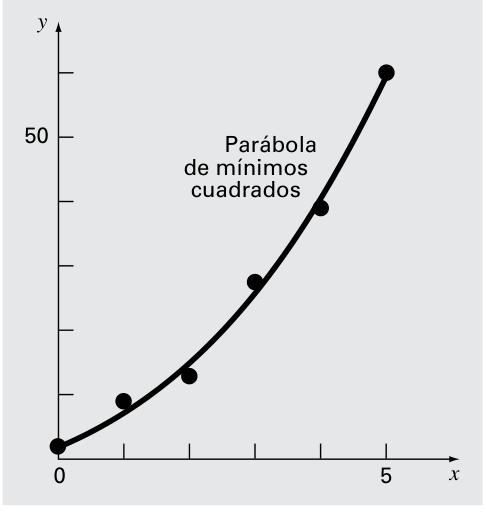
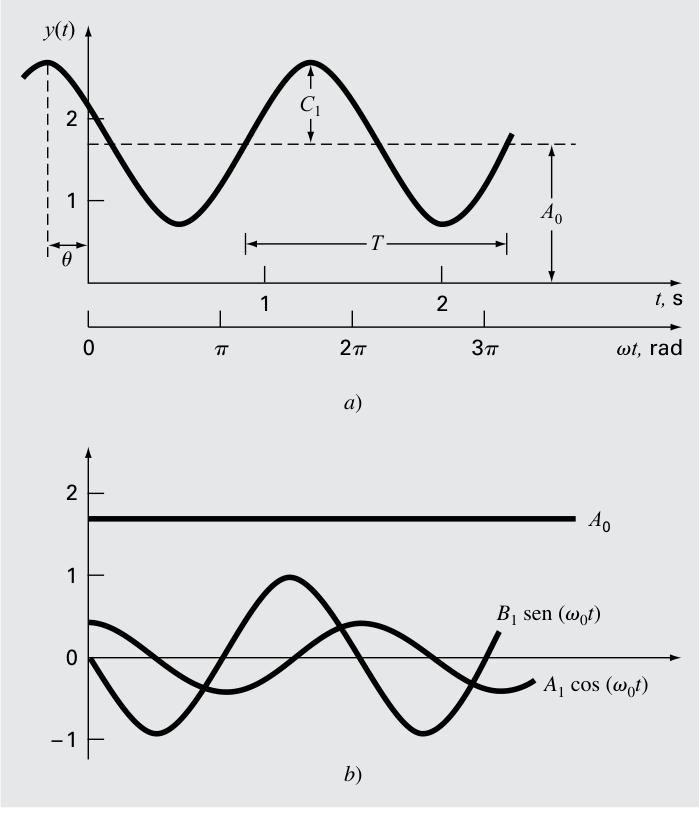

# Regresión por Mínimos Cuadrados: Lineal y Cuadrática

| ⬅️ Anterior | 🏠 Inicio | Siguiente ➡️ |
|:---|:---:|---:|
| [Polinomios de Lagrange](03_lagrange.md) | [README](../../README.md) | [Comparativa interpolación vs regresión](05_comparativa_interpolacion_regresion.md) |

> **Tema 4.3 del programa.** Contenido basado en las secciones 17.1–17.2 del
> libro (ecuaciones 17.1–17.20) y en la sección 19.1 para el ajuste
> sinusoidal.

## 📑 Índice

1. [El criterio de mínimos cuadrados](#sec-1)
2. [Regresión lineal](#sec-2)
3. [Ejemplo 17.1 y cuantificación del error](#sec-3)
4. [Regresión polinomial y cuadrática](#sec-4)
5. [Ejemplo 17.5](#sec-5)
6. [Del libro: ajuste sinusoidal](#sec-6)
7. [Implementación y verificación](#sec-7)

---

### <a id="sec-1"></a>1. El criterio de mínimos cuadrados

**📘 Teoría.** Se tienen $n$ observaciones $(x_i,y_i)$ y se propone un modelo
$y=a_0+a_1x+e$, donde $e$ es el residuo:

$$e=y-a_0-a_1x. \tag{17.1}$$

El libro descarta tres criterios antes de llegar al correcto:

| Criterio | Por qué falla |
|---|---|
| Minimizar $\sum e_i$ (17.2) | Los errores positivos y negativos se cancelan |
| Minimizar $\sum\lvert e_i\rvert$ | Puede haber infinitas rectas con el mismo mínimo |
| Minimax (minimizar el error máximo) | Un solo punto atípico domina el ajuste |

El criterio que sí produce una solución única es minimizar la **suma de los
cuadrados de los residuos**:

$$S_r=\sum_{i=1}^{n}e_i^2
=\sum_{i=1}^{n}\left(y_i-a_0-a_1x_i\right)^2. \tag{17.3}$$



*Figura 17.2. a) Minimizar la suma de residuos los cancela; b) minimizar la suma de valores absolutos deja infinitas rectas; c) minimax da peso excesivo a un punto atípico.*

**🧮 Por qué funciona.** $S_r$ es una función cuadrática de los coeficientes,
estrictamente convexa; su único mínimo se obtiene igualando a cero las
derivadas parciales $\partial S_r/\partial a_0$ y $\partial S_r/\partial a_1$.

---

### <a id="sec-2"></a>2. Regresión lineal

**📘 Teoría.** Al derivar (17.3) respecto a cada coeficiente e igualar a cero,
se obtienen las **ecuaciones normales**:

$$n\,a_0+\left(\sum x_i\right)a_1=\sum y_i, \tag{17.4}$$

$$\left(\sum x_i\right)a_0+\left(\sum x_i^2\right)a_1=\sum x_iy_i. \tag{17.5}$$

Resolviendo el sistema $2\times2$:

$$a_1=\frac{n\sum x_iy_i-\sum x_i\sum y_i}{n\sum x_i^2-\left(\sum x_i\right)^2}, \tag{17.6}$$

$$a_0=\bar y-a_1\bar x. \tag{17.7}$$

La ecuación (17.7) garantiza que la recta pasa por el punto
$(\bar x,\bar y)$: es una comprobación rápida de que el cálculo está bien.

---

### <a id="sec-3"></a>3. Ejemplo 17.1 y cuantificación del error

**🧮 Ejemplo 17.1 del libro.** Datos de la tabla 17.1:

| $x_i$ | 1 | 2 | 3 | 4 | 5 | 6 | 7 |
|---|---|---|---|---|---|---|---|
| $y_i$ | 0.5 | 2.5 | 2.0 | 4.0 | 3.5 | 6.0 | 5.5 |

Con $n=7$, $\sum x_i=28$, $\sum y_i=24$, $\sum x_i^2=140$ y
$\sum x_iy_i=119.5$:

$$a_1=\frac{7(119.5)-(28)(24)}{7(140)-(28)^2}=\frac{164.5}{196}=0.8392857,$$

$$a_0=\frac{24}{7}-0.8392857(4)=0.07142857.$$

Por lo tanto,

$$y=0.07142857+0.8392857x.$$

**📘 Cuantificación del error.** El **error estándar de la estimación** mide la
dispersión alrededor de la recta, no alrededor de la media:

$$s_{y/x}=\sqrt{\frac{S_r}{n-2}}. \tag{17.9}$$

Se divide entre $n-2$ porque se estimaron dos coeficientes ($a_0$ y $a_1$): se
perdieron dos grados de libertad. La **suma total de cuadrados** alrededor de
la media es

$$S_t=\sum_{i=1}^{n}\left(y_i-\bar y\right)^2.$$

La mejora respecto a usar sólo el promedio se normaliza como

$$r^2=\frac{S_t-S_r}{S_t}, \tag{17.10}$$

donde $r^2$ es el **coeficiente de determinación** y $r=\sqrt{r^2}$ el
**coeficiente de correlación**. Una forma equivalente y más cómoda de calcular
$r$ es

$$r=\frac{n\sum x_iy_i-\left(\sum x_i\right)\left(\sum y_i\right)}
{\sqrt{n\sum x_i^2-\left(\sum x_i\right)^2}\sqrt{n\sum y_i^2-\left(\sum y_i\right)^2}}. \tag{17.11}$$



*Figura 17.4. La regresión reduce la dispersión: a) alrededor de la media; b) alrededor de la recta de mejor ajuste.*

**🧮 Ejemplo 17.2 del libro.** Para los datos del ejemplo 17.1:

$$S_t=22.7143,\quad S_r=2.9911,$$

$$s_y=\sqrt{\frac{22.7143}{7-1}}=1.9457\ \text{(desviación total)},$$

$$s_{y/x}=\sqrt{\frac{2.9911}{7-2}}=0.7735\ \text{(error estándar)}.$$

Como $s_{y/x}<s_y$, la recta mejora la predicción. La bondad del ajuste es

$$r^2=\frac{22.7143-2.9911}{22.7143}=0.868,\qquad r=0.932,$$

es decir, el modelo lineal explica el $86.8\%$ de la incertidumbre original.

**⚠️ Advertencia del libro.** Un $r$ cercano a 1 **no** prueba que la relación
sea lineal: puede ocurrir con datos que siguen una curva suave. Siempre hay
que graficar los datos junto con el modelo.

---

### <a id="sec-4"></a>4. Regresión polinomial y cuadrática

**📘 Teoría.** Para un polinomio de segundo grado,

$$y=a_0+a_1x+a_2x^2+e,$$

la suma de cuadrados es

$$S_r=\sum_{i=1}^{n}\left(y_i-a_0-a_1x_i-a_2x_i^2\right)^2. \tag{17.18}$$

Al derivar respecto a $a_0,a_1,a_2$ e igualar a cero se obtiene el sistema de
**ecuaciones normales**:

$$\begin{aligned}
(n)a_0+\left(\sum x_i\right)a_1+\left(\sum x_i^2\right)a_2&=\sum y_i,\\
\left(\sum x_i\right)a_0+\left(\sum x_i^2\right)a_1+\left(\sum x_i^3\right)a_2&=\sum x_iy_i,\\
\left(\sum x_i^2\right)a_0+\left(\sum x_i^3\right)a_1+\left(\sum x_i^4\right)a_2&=\sum x_i^2y_i.
\end{aligned} \tag{17.19}$$

Para un polinomio de grado $m$ se obtiene un sistema de $m+1$ ecuaciones. El
error estándar ajusta los grados de libertad:

$$s_{y/x}=\sqrt{\frac{S_r}{n-(m+1)}}. \tag{17.20}$$

El coeficiente de determinación se sigue calculando con (17.10).

**🧮 Estructura matricial (extensión).** Las ecuaciones normales son

$$\left(\mathbf{V}^{\mathsf T}\mathbf{V}\right)\mathbf{a}
=\mathbf{V}^{\mathsf T}\mathbf{y},\qquad
\mathbf{V}=\begin{bmatrix}
1&x_1&x_1^2&\cdots&x_1^m\\
1&x_2&x_2^2&\cdots&x_2^m\\
\vdots&\vdots&\vdots&&\vdots\\
1&x_n&x_n^2&\cdots&x_n^m
\end{bmatrix}.$$

Es exactamente el mismo sistema de (17.19), escrito de forma compacta. En los
cuadernos la matriz se escribe con la sintaxis del curso,

```python
A = M.sym[[n, sum(x), sum(x**2)],
          [sum(x), sum(x**2), sum(x**3)],
          [sum(x**2), sum(x**3), sum(x**4)]]
mostrar(A)
sol = A.LUsolve(b)
```

y `mostrar()` la pinta en LaTeX. El libro resuelve el mismo sistema con
eliminación de Gauss en el capítulo 3. La función `minimos_cuadrados` de
`lib/ajuste_curvas.py` usa NumPy internamente; la sintaxis matricial es la del
alumno, no la de la biblioteca.

---

### <a id="sec-5"></a>5. Ejemplo 17.5

**🧮 Datos del libro (tabla 17.4).**

| $x_i$ | 0 | 1 | 2 | 3 | 4 | 5 |
|---|---|---|---|---|---|---|
| $y_i$ | 2.1 | 7.7 | 13.6 | 27.2 | 40.9 | 61.1 |

Con $m=2$, $n=6$:

$$\sum x_i=15,\quad \sum x_i^2=55,\quad \sum x_i^3=225,\quad \sum x_i^4=979,$$

$$\sum y_i=152.6,\quad \sum x_iy_i=585.6,\quad \sum x_i^2y_i=2488.8.$$

El sistema es

$$\begin{bmatrix}6&15&55\\15&55&225\\55&225&979\end{bmatrix}
\begin{bmatrix}a_0\\a_1\\a_2\end{bmatrix}
=\begin{bmatrix}152.6\\585.6\\2488.8\end{bmatrix},$$

cuya solución es

$$a_0=2.47857,\qquad a_1=2.35929,\qquad a_2=1.86071.$$

Por lo tanto,

$$y=2.47857+2.35929x+1.86071x^2.$$

El error estándar y la bondad del ajuste son

$$s_{y/x}=\sqrt{\frac{3.74657}{6-3}}=1.12,$$

$$r^2=\frac{2513.39-3.74657}{2513.39}=0.99851,\qquad r=0.99925.$$

El modelo explica el $99.851\%$ de la incertidumbre. La figura 17.11 del libro
muestra que la parábola sigue la tendencia de los datos.



*Figura 17.11. La parábola de mínimos cuadrados sigue la tendencia de los datos del ejemplo 17.5.*

**⚠️ Cuidado con el grado.** Subir $m$ siempre reduce $S_r$ (con datos
suficientes), pero no siempre mejora la predicción. Un polinomio de grado
$n-1$ interpola exactamente los $n$ datos y suele oscilar entre ellos. El
grado se elige por el fenómeno físico y por el error estándar, no por maximizar
$r^2$.

---

### <a id="sec-6"></a>6. Del libro: ajuste sinusoidal

> **Origen:** sección 19.1 del libro. Se incluye aquí porque es el mismo
> criterio de mínimos cuadrados con otra base de funciones, y es la base de la
> aplicación de Fourier de esta unidad.

**📘 Teoría.** Una sinusoide se escribe con cuatro parámetros:

$$f(t)=A_0+C_1\cos(\omega_0t+\theta). \tag{19.2}$$



*Figura 19.3. $A_0$ fija el valor medio, $C_1$ la amplitud, $T$ el periodo y $\theta$ el corrimiento de fase.*

Usando la identidad del coseno de una suma y agrupando,

$$f(t)=A_0+A_1\cos(\omega_0t)+B_1\sin(\omega_0t), \tag{19.6}$$

con

$$A_1=C_1\cos\theta,\qquad B_1=-C_1\sin\theta, \tag{19.7}$$

$$\theta=\arctan\left(-\frac{B_1}{A_1}\right),\qquad
C_1=\sqrt{A_1^2+B_1^2}. \tag{19.8–19.9}$$

El modelo es **lineal en los coeficientes** $A_0,A_1,B_1$ aunque no lo sea en
$\theta$. Por eso se resuelve con las ecuaciones normales (19.12).

**📘 Caso de datos igualmente espaciados.** Si hay $N$ observaciones separadas
$\Delta t$ a lo largo de un periodo completo, las sumas cruzadas se anulan y
las ecuaciones normales se simplifican a

$$A_0=\frac{\sum y}{N},\qquad
A_1=\frac{2}{N}\sum y\cos(\omega_0t),\qquad
B_1=\frac{2}{N}\sum y\sin(\omega_0t). \tag{19.14–19.16}$$

**🧮 Ejemplo 19.1 del libro.** Para
$y=1.7+\cos(4.189t+1.0472)$ muestreada en 10 puntos ($t=0$ a $1.35$,
$\Delta t=0.15$), las sumas dan

$$A_0=\frac{17.000}{10}=1.7,\quad
A_1=\frac{2}{10}(2.502)=0.500,\quad
B_1=\frac{2}{10}(-4.330)=-0.866,$$

de donde

$$y=1.7+0.500\cos(4.189t)-0.866\sin(4.189t),$$

$$\theta=\arctan\left(\frac{0.866}{0.500}\right)=1.0472,\qquad
C_1=\sqrt{0.5^2+0.866^2}=1.00.$$

**⚠️ Nota de honestidad numérica.** Las fórmulas (19.14–19.16) suponen un
número entero de periodos. En el ejemplo, la ventana de $1.35$ s cubre $0.9$
periodos, así que la solución exacta de las ecuaciones normales (19.12) da
$A_1\approx0.5003$ y $B_1\approx-0.8661$: coinciden con el libro hasta la
tercera decimal. Para datos que no completan periodos, usa las ecuaciones
normales completas, no las simplificadas.

---

### <a id="sec-7"></a>7. Implementación y verificación

**💻 Funciones de la unidad.**

| Función | Modelo | Devuelve |
|---|---|---|
| `minimos_cuadrados(x, y, 1)` | $a_0+a_1x$ | `coef`, `Sr`, `St`, `r2`, `syx` |
| `minimos_cuadrados(x, y, 2)` | $a_0+a_1x+a_2x^2$ | idem |
| `minimos_cuadrados(x, y, m)` | grado $m$ | idem |
| `ajuste_sinusoidal(t, y, w0)` | (19.11) | `A0`, `A1`, `B1`, `C1`, `theta`, `Sr` |

```python
import numpy as np
from ajuste_curvas import minimos_cuadrados

x = np.arange(1.0, 8.0)
y = np.array([0.5, 2.5, 2.0, 4.0, 3.5, 6.0, 5.5])
r = minimos_cuadrados(x, y, 1)
print(r["coef"], r["r2"], r["syx"])   # [0.0714 0.8393] 0.868 0.7735
```

**✅ Verificación.**

1. `St` debe ser el mismo para todos los grados (depende sólo de $y$).
2. `r2` debe estar en $[0,1]$ y crecer o quedarse igual al subir el grado.
3. La recta debe pasar por $(\bar x,\bar y)$.
4. El residual debe tener media cero.

```python
assert abs(np.mean(r["residuales"])) < 1e-12
assert abs(r["coef"][0] + r["coef"][1] * x.mean() - y.mean()) < 1e-10
```

**⚠️ Errores comunes.**

- Reportar $r^2$ sin graficar: un ajuste puede tener $r^2$ alto y forma
  equivocada.
- Usar extrapolación fuera del rango de los datos.
- Comparar $S_r$ entre datasets distintos: $S_r$ depende de la escala.
- Elegir el grado por $r^2$ y no por el fenómeno; el sobreajuste es real.
