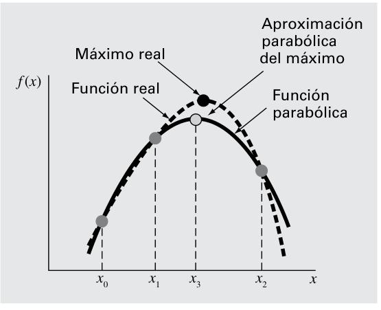

# Comparativa: Interpolación, Lagrange, Newton y Mínimos Cuadrados

| ⬅️ Anterior | 🏠 Inicio |
|:---|:---:|
| [Mínimos cuadrados](04_minimos_cuadrados_lineal_cuadratico.md) | [README](../../README.md) |

> **Cierre del bloque 4.1–4.3.** Este documento no agrega fórmulas nuevas:
> ordena las decisiones. Las referencias entre paréntesis remiten a las
> ecuaciones del libro.

## 📑 Índice

1. [Las cuatro herramientas](#sec-1)
2. [Tabla de decisión](#sec-2)
3. [Errores y costo](#sec-3)
4. [Puente con optimización](#sec-4)
5. [Checklist antes de entregar](#sec-5)

---

### <a id="sec-1"></a>1. Las cuatro herramientas

| Herramienta | Qué produce | Pasa por los datos | Cuándo se usa |
|---|---|:---:|---|
| Interpolación lineal | Recta entre dos nodos | Sí | Estimación rápida, tablas densas |
| Interpolación cuadrática | Parábola por tres nodos | Sí | Se necesita curvatura local |
| Newton / Lagrange | Polinomio de grado $n$ por $n+1$ nodos | Sí | Datos exactos, interpolación fina |
| Mínimos cuadrados | Polinomio de grado $m<n-1$ | No | Datos con ruido, tendencia |

Las tres primeras son **interpolación**; la cuarta es **regresión**. La
frontera es el número de coeficientes: si iguala al número de datos, interpola;
si es menor, ajusta.

---

### <a id="sec-2"></a>2. Tabla de decisión

```text
¿Los datos son exactos y confiables?
├── Sí → ¿Cuántos nodos rodean al punto?
│        ├── 2  → lineal (18.2)
│        ├── 3  → cuadrática (18.3)–(18.6)
│        └── más → Newton (18.7) o Lagrange (18.20)
└── No → ¿La tendencia es lineal?
         ├── Sí → mínimos cuadrados grado 1 (17.4)–(17.7)
         └── No → mínimos cuadrados grado 2 (17.19)
                  (o una transformación / modelo físico)
```

**🔢 Preguntas que resuelven la duda.**

1. ¿El punto a estimar está dentro del rango de los datos? Si no, ningún
   polinomio es confiable: extrapolar es una decisión física, no numérica.
2. ¿Los datos vienen de una medición con error? Entonces interpolar reproduce
   el ruido; usa regresión.
3. ¿Se van a agregar nodos después? Newton guarda la tabla y permite hacerlo
   con un término extra; Lagrange obliga a recalcular.
4. ¿Se necesita estimar el error sin conocer la función? Newton con (18.18);
   Lagrange no lo facilita.

---

### <a id="sec-3"></a>3. Errores y costo

| Método | Fórmula del error | Costo de construir | Costo de evaluar |
|---|---|---|---|
| Lineal | (18.16) con $n=1$ | $O(1)$ | $O(1)$ |
| Cuadrática | (18.16) con $n=2$ | $O(1)$ | $O(1)$ |
| Newton | (18.18) con un punto extra | $O(n^2)$ | $O(n)$ con Horner |
| Lagrange | (18.17), pero no se calcula en la práctica | $O(n^2)$ por evaluación | $O(n^2)$ |
| Mínimos cuadrados | $s_{y/x}$ (17.9) o (17.20) | resolver $(m+1)\times(m+1)$ | $O(m)$ |

**📘 Interpretación.** El error de interpolación depende de
$\prod(x-x_i)$: crece al alejarse de los nodos. El error de regresión,
$s_{y/x}$, mide la dispersión vertical alrededor del modelo y **no** desaparece
al agregar coeficientes: si se agregan demasiados, $s_{y/x}$ puede bajar
artificialmente y el modelo empieza a interpolar el ruido.

**⚠️ Mal condicionamiento.** Los polinomios de grado alto son sensibles a
pequeños cambios en los datos. El libro lo muestra al comparar grados en el
ejemplo 18.5: el error no baja de forma monótona con el grado. Si se necesitan
muchos nodos, la respuesta profesional son los trazadores cúbicos (sección
18.6, fuera de esta unidad).

---

### <a id="sec-4"></a>4. Puente con optimización

> **Origen:** capítulo 4 del libro, sección 13.2 (interpolación parabólica).
> Se incluye porque usa exactamente el polinomio cuadrático de la sección 3 de
> esta unidad, pero con otro objetivo: **encontrar un óptimo**, no estimar un
> valor intermedio.

**📘 Teoría.** Si tres puntos contienen un máximo o un mínimo, se ajusta la
parábola que pasa por ellos y se calcula su vértice. La abscisa del vértice es

$$x_3=\frac{f(x_0)(x_1^2-x_2^2)+f(x_1)(x_2^2-x_0^2)+f(x_2)(x_0^2-x_1^2)}
{2f(x_0)(x_1-x_2)+2f(x_1)(x_2-x_0)+2f(x_2)(x_0-x_1)}. \tag{13.7}$$

Después se descarta el punto que queda del lado opuesto al nuevo y se repite.



*Figura 13.6. La parábola que pasa por tres puntos aproxima el máximo de la función; su vértice da el nuevo $x_3$.*

**🧮 Ejemplo 13.2 del libro.** Para $f(x)=2\sin x-x^2/10$ con
$x_0=0,\ x_1=1,\ x_2=4$:

$$f(0)=0,\quad f(1)=1.5829,\quad f(4)=-3.1136,$$

$$x_3=1.5055,\qquad f(x_3)=1.7691.$$

En la segunda iteración, con $(1,\ 1.5055,\ 4)$, se obtiene
$x_3=1.4903$ y $f=1.7714$, acercándose al máximo real
$x\approx1.4276$.

**🔢 Lectura.** La misma fórmula (18.3) que interpola $\ln 2$ sirve para
localizar un óptimo. La diferencia está en **cómo se eligen los nodos**: en
interpolación se eligen alrededor del punto de consulta; en optimización se
eligen alrededor del óptimo y se descartan extremos.

---

### <a id="sec-5"></a>5. Checklist antes de entregar

- [ ] ¿Graficaste los datos y el modelo en la misma figura?
- [ ] ¿El polinomio pasa por los nodos (si es interpolación)?
- [ ] ¿Reportaste el error con la fórmula correcta y sus unidades?
- [ ] ¿Justificaste el grado por el fenómeno, no sólo por $r^2$?
- [ ] ¿Evitaste extrapolar fuera del rango de los datos?
- [ ] ¿Verificaste el resultado con una segunda vía (por ejemplo, Lagrange
      contra Newton, o residual medio cero en regresión)?
- [ ] ¿Distinguiste lo que es del libro de lo que es una extensión propia?
